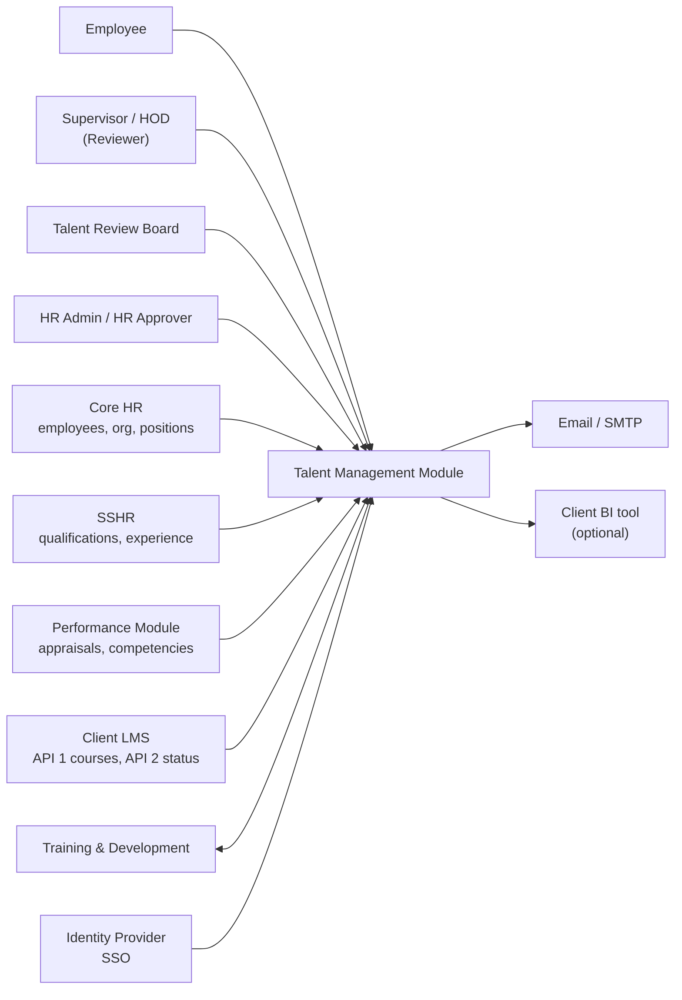
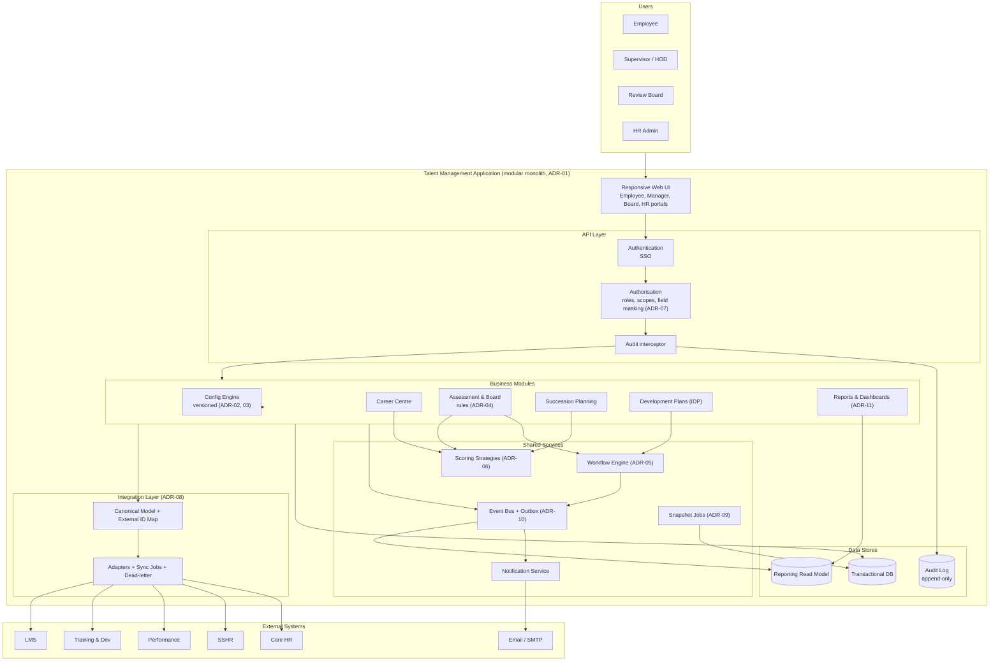
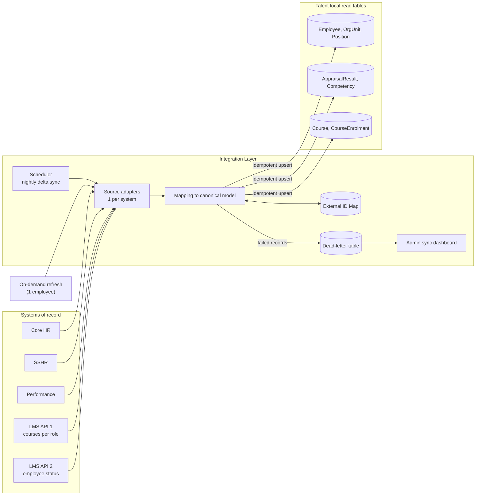
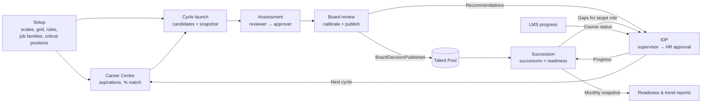
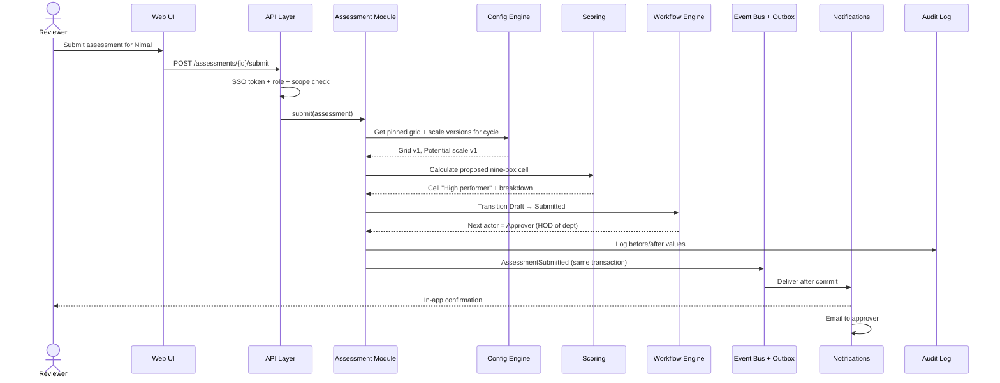
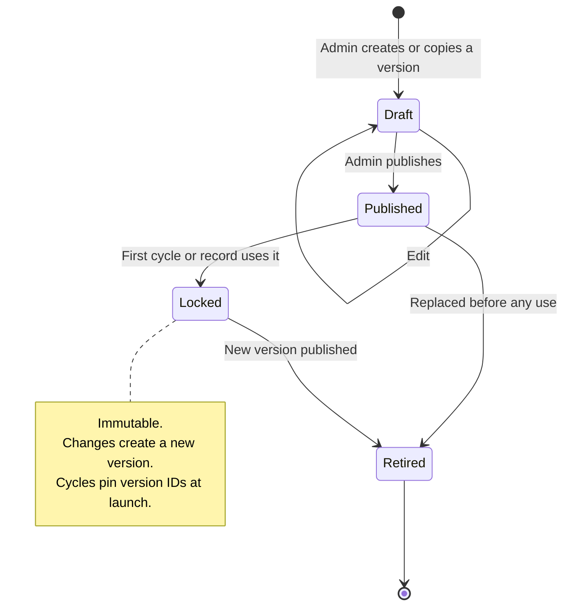
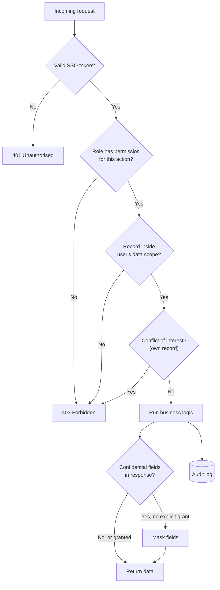
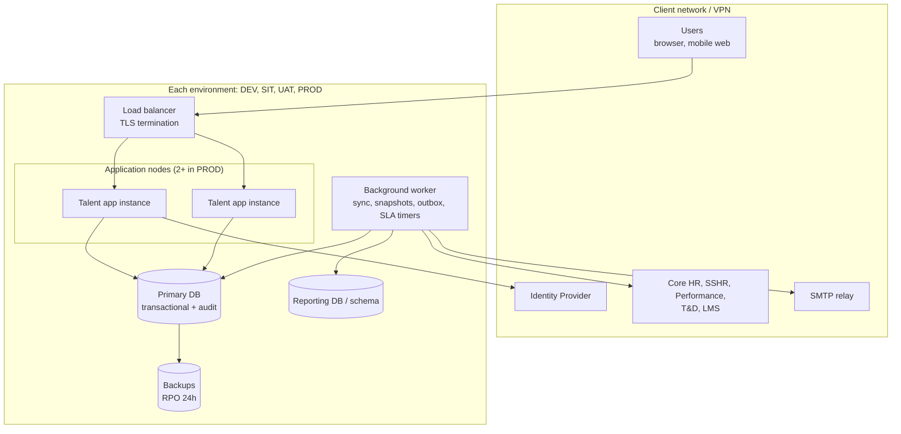

# Talent Management Module: Architecture Diagrams

Mermaid diagrams for [talent-solution-architecture.md](talent-solution-architecture.md). They render on GitHub, GitLab, Azure DevOps, Confluence (with the Mermaid plugin) and [mermaid.live](https://mermaid.live).

| # | Diagram | Shows |
|---|---|---|
| 1 | System context | Who uses the system and which systems it connects to |
| 2 | Component view | The layers and modules inside the application |
| 3 | Integration and sync | How external data flows in (ADR-08) |
| 4 | Business flow across modules | How the 4 lifecycle phases connect through events |
| 5 | Assessment sequence | 1 request traced through every layer |
| 6 | Configuration versioning | Life of a config version (ADR-02) |
| 7 | Security check | How every request is authorised (ADR-07) |
| 8 | Deployment view | Environments and runtime pieces |

---

## 1. System context

---

## 2. Component view (modular monolith)

---

## 3. Integration and sync flow

---

## 4. Business flow across modules

---

## 5. Assessment submission sequence

---

## 6. Configuration versioning

---

## 7. Security check on every request

---

## 8. Deployment view

Hosting is still open (blocker B7). The runtime pieces are the same on-premise or in the cloud.

