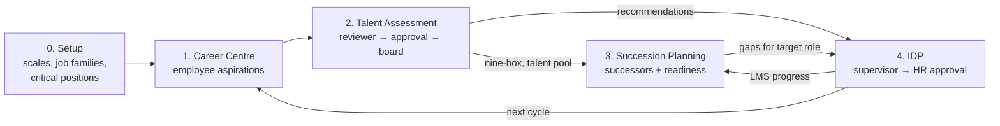

# Talent Management Module: Blueprint Gap Analysis and End-to-End Solution Proposal

| | |
|---|---|
| **Source document** | Talent Management – Blue Print Document, V1.0, 06/10/2026, owner Nishani Randika (17 pages) |
| **Prepared by** | Solution Architecture / Technical Lead |
| **Date** | 24/10/2026 |
| **Status** | Draft for internal review, then client clarification workshop |
| **Purpose** | Find gaps, conflicts and missing information in the blueprint before sign-off. Propose the full end-to-end solution. |

> **Why this matters before sign-off:** The sign-off page (p.17) says the blueprint replaces the RFP, tender and all earlier documents. After sign-off, anything that is missing or vague here becomes a dispute or a change request. Every gap below should be closed, or written down as an assumption, **before the client signs**.

---

## 1. What the blueprint covers today

| Area | Covered in blueprint | Detail level |
|---|---|---|
| Lifecycle (4 phases) | p.4–5 | Description only. The Figure 1 diagram is missing. |
| Main operations (15 steps) | p.5 | List of operations and who does them |
| Administration setup | p.6–7 | List of screens, with a few notes |
| Career Centre | p.8–9 flowchart | Screen flow only |
| Talent Assessment | p.10–11 flowchart | Screen flow only |
| Succession Planning | p.12–13 flowchart | Screen flow plus field lists |
| Individual Development Plan (IDP) | p.14–15 flowchart | Screen flow plus field lists |
| LMS integration | p.7 | 3 bullets. The APIs depend on the client. |
| Reports | p.6 | Readiness reports. Templates still to come from the client. |
| Alerts | p.16 | 4 alerts. All alert text still to come from the client. |
| Annexure | Listed in contents | **No content** |
| Business rules, data, NFRs, security, migration, testing | — | **Not covered** |

---

## 2. Document-level issues

| # | Issue | Fix |
|---|---|---|
| D1 | The contents page lists Annexure (p.16) and Sign Off (p.18). The document has 17 pages and no Annexure. | Add the Annexure (templates, scales, samples) or remove it from the contents |
| D2 | Figure 1 (lifecycle diagram, p.4) has a caption but no picture | Insert the diagram |
| D3 | The operations table (p.5) skips **Step 8** | Confirm whether a step is missing. It may be "Approve Initial Assessment" (see flowchart p.10). |
| D4 | "Scales" are defined in Step 1, but no scale is described anywhere | Add all rating scales (see G-A1) |
| D5 | The client name is still a `<client>` placeholder | Fill it in before sign-off |
| D6 | The note "Performance appraisal information supports…" appears twice (p.6 and p.7). Its grammar is also wrong ("It identify"). | Clean up |
| D7 | Sign-off removes the RFP and tender. If the blueprint is silent on a topic, that topic is out of scope. | Add an explicit **Out of Scope** section and an **Assumptions** section |
| D8 | The blueprint covers business process only. It has no data, integration, security or NFR section. | Add as sections, or as a companion Solution Design Document |

---

## 3. Inconsistencies and logic conflicts

These must be resolved because they change how the system is built.

| # | Conflict | Where | Question to client |
|---|---|---|---|
| C1 | The lifecycle says the **assigned reviewer** assesses talent. The operations table says **Supervisor/HOD**. | p.4 vs p.5 step 7 | Who is the reviewer: the direct supervisor, the HOD, or an admin-configured person? Can there be more than one? |
| C2 | The **review board meeting** must be "on or before the Reviewer Cut-off Date". Logically, the board reviews nominations **after** reviewers finish. | p.11 | Should the board meeting be **after** the reviewer cut-off? Do we need a separate "Board Cut-off Date"? |
| C3 | The lifecycle says the **Talent Review Board** plans succession. The operations table and p.7 say succession planning is an **Admin operation**. | p.4 vs p.5 step 12, p.7 | Who creates and edits succession plans? Who approves them? |
| C4 | IDP approval is an "**Admin Operation**" in the table, but "**HR Approver**" in alerts #3 and #4 | p.5 step 15 vs p.16 | Is HR Approver a separate role from HR Admin? |
| C5 | Alert #1 says "once Career Centre details are **submitted**, remind the **reviewer**". The Career Centre flow ends at **Save**. It has no submit step and no reviewer. | p.9 vs p.16 | Does the Career Centre need a submit/review step? Who reviews career preferences? |
| C6 | Step 10 says the "Assigned **Head** of the Talent Review Board" does the review. The flowchart says the "Review **Board**" does it. | p.5 vs p.11 | Does only the board head enter decisions, or all members? Is a vote or quorum needed? |
| C7 | Flowchart p.10 shows "Approve Initial Talent Assessment by **relevant authorized persons**". This role is not named anywhere. | p.10 | Who approves? Is it single-level or multi-level? |
| C8 | Step 7 says the assessment is "Talent Profile **and Nine Box Grid**". Step 10 says the board does the nine-box placement. | p.5 | Does the reviewer propose a placement and the board confirm it? Can the board override it? |
| C9 | The IDP flow (p.14) asks "Update Development Plan?". Nothing explains how an IDP is **first created**. | p.14–15 | Is the IDP created automatically from talent review results, by the supervisor, or by the employee? |

---

## 4. Gap analysis by functional area

Priority: **H** = blocks design or build. **M** = needed before UAT. **L** = nice to have or can be assumed.

### 4.1 Administration and master data

| ID | Gap / missing information | Impact | Pri |
|---|---|---|---|
| G-A1 | **Rating scales** are not defined. We need the potential scale, performance scale, readiness scale, risk of loss, impact of loss and the IDP overall rating. For each: levels, labels, numbers, colours. | Cannot build assessment, nine-box or succession | H |
| G-A2 | **Nine Box Grid** is not defined. We need the axis definitions (performance vs potential), the box labels (e.g. "Future Leader") and the rules that place an employee in a box (calculated or manual). | Core feature cannot be designed | H |
| G-A3 | **Job family structure** is not defined. Is it 1 or more levels? Can a job belong to more than one family? How are grades and levels shown? | Career path design | H |
| G-A4 | **Alternative career paths**: no rules. Lateral moves, cross-family moves, how many paths per job? | Career Centre | M |
| G-A5 | **Job profile data** for match-up: where do job qualification, experience and competency requirements come from? Who keeps them up to date? | Profile match-up cannot work without it | H |
| G-A6 | **Talent Assessment Competencies**: they come from the Performance module. Are they per cycle, per job or per job family? Do they have weights? Which proficiency scale? | Assessment form | H |
| G-A7 | **Talent Review Board** setup: who can be a member, how many, is there a quorum, one board per department or org-wide? Conflict-of-interest rule (a member cannot review themselves or a direct relative)? | Workflow and security | M |
| G-A8 | **Talent groups / talent pools** appear in the succession flow ("Talent Group", "Latest Talent Pool"). They are never defined. How are they created? | Succession search | H |
| G-A9 | **Org structure source**: departments, cost centres, locations, work stations, positions. Do they come from Core HR? Is it position-based or job-based? | Data model | H |

### 4.2 Career Centre

| ID | Gap | Impact | Pri |
|---|---|---|---|
| G-C1 | **% match algorithm** is not defined: how qualification, experience and competency are scored and weighted. | Core calculation. Results will be challenged in UAT. | H |
| G-C2 | Resume data is updated in **SSHR**. Is SSHR in our scope? Is it already live? Is the data real-time or synced? | Dependency | H |
| G-C3 | "Search for preferred jobs **within the organization**": is it all jobs or only vacancies? Should it link to internal recruitment? | Scope | M |
| G-C4 | **Mobility / relocation**: field list and allowed values (yes/no/conditional, time frame, location list) | Form design | M |
| G-C5 | **Visibility**: can supervisors, HR and boards see an employee's career aspirations? Can the employee edit them at any time, or only during a window? | Privacy, RBAC | M |
| G-C6 | **History**: are past aspirations kept for each cycle? | Data model | L |
| G-C7 | **Eligibility**: can all employees use Career Centre, or only some categories (e.g. not probation or contract staff)? | Access | M |

### 4.3 Talent Assessment

| ID | Gap | Impact | Pri |
|---|---|---|---|
| G-T1 | **Leadership candidate selection criteria**: which appraisal cycle, rating threshold, grade, service length? Is selection automatic, manual, or auto-suggest plus manual? | Core rule | H |
| G-T2 | **Talent Profile** contents are not defined: which fields and sections does the reviewer fill in? | Form design | H |
| G-T3 | **Review cycle parameters**: frequency (annual?), how many cycles can run at once, start/end/cut-off dates, what happens to late assessments | Workflow | H |
| G-T4 | **Reject / send-back paths**: no flow covers an approver rejecting an assessment or a board sending it back | Workflow is incomplete | H |
| G-T5 | **Calibration**: can the board change the reviewer's rating or box? Is the reason required? Are both values kept? | Audit, data model | H |
| G-T6 | **Board meeting**: is the meeting only recorded in the system, or does it need calendar integration (Outlook/Teams)? Are minutes and attendance captured? | Integration scope | M |
| G-T7 | **Employee transparency**: does the employee see their box or outcome? (In most organisations they do not.) | Security | H |
| G-T8 | **Reviewer changes mid-cycle**: what happens on transfer, resignation or long leave of the reviewer or employee? | Edge cases | M |
| G-T9 | **Recommendations** (p.11): free text, or chosen from a list (promotion, IDP, rotation, retention action)? Do they flow into the IDP or succession plan? | Integration between sub-modules | M |

### 4.4 Succession Planning

| ID | Gap | Impact | Pri |
|---|---|---|---|
| G-S1 | **Critical position list** is not provided. The text says "HOD roles and some others, such as HRO Payroll". Who flags a position as critical? What are the criteria? | Data and setup | H |
| G-S2 | **Risk of Loss / Impact of Loss**: who sets them, which scale, and are they per incumbent or per position? | Display and reports | H |
| G-S3 | **Successor Bench Strength**: no formula (e.g. number of "ready now" successors, or a weighted score) | Calculation | H |
| G-S4 | **Readiness levels** not defined (e.g. Ready Now / 1–2 yrs / 3+ yrs) | Core field. Drives all reports. | H |
| G-S5 | **Successor limits**: maximum successors per position? Can one employee succeed several positions? Is the ranking unique? | Validation | M |
| G-S6 | **Approval of the succession plan**: none shown. Is a plan final as soon as it is saved? | Governance | M |
| G-S7 | **External successors**: are external candidates allowed? | Scope | L |
| G-S8 | **Change history** for readiness: needed for trend reports. Keep a snapshot per month or quarter. | Data model. Must be designed in from day 1. | H |
| G-S9 | **Confidentiality**: who can see who is a successor? Is the incumbent hidden from their own plan? | Security | H |

### 4.5 Individual Development Plan (IDP)

| ID | Gap | Impact | Pri |
|---|---|---|---|
| G-D1 | **Employee role is missing**. In the flow only the supervisor and HR work on the IDP. Can the employee view it, accept it, comment on it, or update progress? | Process and UX | H |
| G-D2 | **IDP creation trigger** (see C9) | Workflow | H |
| G-D3 | **Action step structure**: types (training, coaching, rotation, project), target dates, owners, measures, link to LMS course | Data model | H |
| G-D4 | **Progress %**: how is it calculated (manual, or from completed actions or LMS status)? | Calculation | H |
| G-D5 | **HR rejection path**: alert #4 covers approval only. What happens on rejection or send-back? | Workflow | H |
| G-D6 | **Review frequency / period / rating method** (p.7): what options are needed? What happens when a period ends? (Auto-create the next review? Remind?) | Scheduler | M |
| G-D7 | "Profile match-up with a **position selected**": is it a target position from succession, or any position? | Linkage | M |

### 4.6 LMS and Training & Development integration

| ID | Gap | Impact | Pri |
|---|---|---|---|
| G-L1 | **API 1 (courses per role/competency)** and **API 2 (employee course status)**: the client has not delivered a spec. We need the endpoint, auth method, payload, paging, rate limits, and test environment. | Blocks integration build | H |
| G-L2 | **Sync model**: real-time call on screen load, or a scheduled batch? How often? | Architecture | H |
| G-L3 | **Master key mapping**: how do roles, competencies and employees match between HRIS and LMS (shared IDs or a mapping table)? | Data quality | H |
| G-L4 | **Direction**: is it read-only? Or do we also **assign** courses in the LMS from the IDP (write-back)? | Scope | H |
| G-L5 | **Failure handling**: what if the LMS is down (cache, retry, message to user)? | Resilience | M |
| G-L6 | "Links to Training and Development Module": is that module **ours** (in scope) or a separate system? What exactly is the link? | Scope | H |

### 4.7 Performance module dependency

| ID | Gap | Impact | Pri |
|---|---|---|---|
| G-P1 | Is the Performance module live, with **historic appraisal data**? How many years are needed for candidate selection? | Data dependency | H |
| G-P2 | Which **appraisal fields** are used: final score, rating band, competency scores? | Integration | H |
| G-P3 | What if the appraisal is not finalised when the talent cycle starts? | Edge case | M |

### 4.8 Reports and dashboards

| ID | Gap | Impact | Pri |
|---|---|---|---|
| G-R1 | **Templates are still to come** (monthly/quarterly readiness, trend analysis, role-wise readiness) | Cannot estimate or build | H |
| G-R2 | Only succession reports are mentioned. **No reports are listed** for Career Centre, Talent Assessment (nine-box distribution, cycle completion status) or IDP (completion, overdue actions). | Expected by HR. Will come up in UAT. | M |
| G-R3 | **Dashboards** for HR, HOD and the board are not mentioned | Scope | M |
| G-R4 | **Export formats** (PDF / Excel), scheduled email delivery, and data-level security on reports | Build | M |

### 4.9 Alerts and notifications

| ID | Gap | Impact | Pri |
|---|---|---|---|
| G-N1 | Alert text for all 4 alerts is "to be provided by client" | Blocks configuration | M |
| G-N2 | **Channel** not stated: email, in-app, SMS, Teams? | Build | M |
| G-N3 | **Missing alerts**. Suggested: cycle launched; reviewer assigned; reviewer cut-off approaching (e.g. 7 and 2 days before); overdue escalation to HOD/HR; assessment approved or returned; board decision published; successor nominated (to HR only); IDP returned; IDP review period due; IDP action overdue; LMS course assigned or completed | Process will stall without reminders | M |
| G-N4 | Alert #1 frequency is "On Request". The meaning is unclear (manual trigger by admin?). | Build | L |

### 4.10 Non-functional requirements (none in the blueprint)

| ID | Missing NFR | Pri |
|---|---|---|
| G-X1 | **Role-based access control (RBAC)** (who can see or do what). A role-permission matrix is needed (see §5.4). | H |
| G-X2 | **Data privacy and confidentiality**: talent and successor data is very sensitive. Field-level masking? Local data protection law compliance? | H |
| G-X3 | **Audit trail**: who changed which rating, box, readiness or approval, and when | H |
| G-X4 | **Volumes**: number of employees, concurrent users, positions, critical positions. Needed for sizing and performance targets. | H |
| G-X5 | **Availability, backup, DR** targets (if hosting is in our scope) | M |
| G-X6 | **Browsers / mobile**: is mobile access needed for employees and supervisors? | M |
| G-X7 | **Language**: is any language other than English needed? | M |
| G-X8 | **SSO / authentication** method (AD / Entra ID / other) | M |
| G-X9 | **Data retention**: how long to keep cycles, assessments and history | L |

### 4.11 Delivery topics not covered

| ID | Missing | Pri |
|---|---|---|
| G-Y1 | **Data migration**: existing job families, critical positions, successors, IDPs, past talent reviews. Is there legacy data? What format? | H |
| G-Y2 | **Test approach and UAT acceptance criteria** for each process | M |
| G-Y3 | **Training plan** (admin, HR, supervisors, employees) and user guides | M |
| G-Y4 | **Go-live approach**: big-bang or phased by sub-module? Pilot department? | M |
| G-Y5 | **Hypercare and support** period and SLA | M |
| G-Y6 | **Deadlines for client dependencies** (templates, APIs, alert text). Without them, delays shift to the vendor. | H |

---

## 5. Proposed end-to-end solution

### 5.1 Business process view

The 4 lifecycle phases are one connected cycle. Outputs from each phase feed the next one.



**End-to-end flow, including the steps the blueprint leaves out (marked ★):**

1. **Setup (HR Admin):** scales ★, job families, job → family, alternative paths, job profile requirements ★, critical positions, risk/impact ★.
2. **Career Centre (Employee):** view resume (from SSHR) → view career paths and % match → enter long-term goal, preferred jobs, mobility, locations → save (→ optional submit to reviewer ★, see C5).
3. **Cycle launch (HR Admin):** define cycle and dates → system suggests leadership candidates from Performance data ★ → admin confirms → assign reviewers → choose competencies → create boards → **launch** ★ (notifications go out).
4. **Assessment (Reviewer):** fill in the talent profile, competency ratings and proposed nine-box → submit before the cut-off.
5. **Initial approval (Authorised approver ★):** approve, or return with comments ★.
6. **Board review (Board Head / members):** meeting is scheduled → calibrate box ★ → comments and recommendations → **publish results** ★ → the talent pool is updated.
7. **Succession (HR Admin / Board ★):** choose a critical position → profile match or search → add successor with readiness, rank and comments → (approve plan ★) → monthly snapshot for trend reports ★.
8. **IDP (Supervisor → HR):** IDP is created from recommendations or succession gaps ★ → action steps (linked to LMS courses) → employee acknowledges ★ → HR approves or returns ★ → progress is tracked from LMS → periodic review.
9. **Close cycle (HR Admin)** ★: lock the data, archive it, start the next cycle.

### 5.2 Solution architecture (logical)

```
                    +----------------------------------------------+
   Users (SSO) ---> |         HRIS Web / Mobile front end          |
   Employee         |  Career Centre | Assessment | Succession |   |
   Supervisor/HOD   |  IDP | Admin setup | Reports & Dashboards    |
   Reviewer, Board  +-----------------------+----------------------+
   HR Admin/Approver                        |
                    +-----------------------v----------------------+
                    |          Talent Management services          |
                    |  Master data | Match-up engine | Workflow &  |
                    |  approvals | Cycle scheduler | Notification |
                    |  engine | Snapshot/trend job | Audit log     |
                    +----+-----------+-----------+-------------+---+
                         |           |           |             |
            +------------v-+  +------v------+ +--v---------+ +-v-------------+
            | Core HR/SSHR |  | Performance | | Training & | | Integration   |
            | employees,   |  | module      | | Development| | layer         |
            | org, quals,  |  | appraisals, | | module     | | (API adapter, |
            | experience   |  | competencies| |            | | retry, cache) |
            +--------------+  +-------------+ +------------+ +-------+-------+
                                                                     |
                                                       +-------------v--------+
                                                       | Client LMS           |
                                                       | API 1: courses/role  |
                                                       | API 2: emp. status   |
                                                       +----------------------+
                    Outbound: Email / in-app (alerts), optional Outlook/Teams calendar
```

**Key design decisions (proposed):**

| Topic | Proposal | Reason |
|---|---|---|
| Single source of truth | Employee, org, qualifications and experience come **only** from Core HR/SSHR. Talent stores references, not copies. | No duplicate data |
| Match-up engine | Configurable weighted score: qualification + experience + competency, with weights per job family. Output 0–100%. | Transparent and explainable to HR (G-C1) |
| Workflow | Use the platform workflow engine with states, returns, delegation and escalation. Do not hard-code the flow. | The client will change approvers |
| LMS integration | Adapter in the integration layer. API 1: nightly batch into a local course catalogue. API 2: nightly batch plus an on-demand refresh. | Screens keep working when the LMS is down |
| Trend reports | A scheduled job saves a **readiness snapshot** per position and successor each month | Trend analysis cannot be rebuilt later without history (G-S8) |
| Security | RBAC plus data scope (own record / team / department / all) plus field masking for talent data | Very sensitive data |
| Audit | Log every change to rating, box, readiness, successor and approval, with before/after values | Calibration and disputes |

### 5.3 Core data entities

```
Scale ─< ScaleLevel
JobFamily ─< Job ─< JobRequirement (qualification / experience / competency)
Job ─< CareerPath (from-job → to-job, type: vertical / alternative)
Employee (from Core HR) ─< CareerAspiration (goal, preferred jobs, mobility, locations, cycle)

TalentReviewCycle ─< CycleCompetency
                  ─< LeadershipCandidate ── Reviewer
                  ─< TalentAssessment ─< CompetencyRating
                                       ── NineBoxPlacement (proposed / calibrated)
                  ─< TalentReviewBoard ─< BoardMember
                                       ─< ReviewMeeting
                  ─< Recommendation
TalentPool / TalentGroup ─< PoolMember

CriticalPosition (position, risk of loss, impact of loss)
   ─< Successor (employee, readiness, rank, comments)
   ─< ReadinessSnapshot (month, successor, readiness)   ← for trend reports

IDP (employee, period, status, overall rating) ─< IDPAction (type, LMS course, due, status, %)
                                               ─< IDPApproval / history
LMSCourse (cached) ─< CourseMapping (role / competency)
EmployeeCourseStatus (cached from LMS API 2)
AuditLog, Notification
```

### 5.4 Proposed role and permission matrix (to confirm with client)

| Function | Employee | Supervisor / HOD (Reviewer) | Approver | Board Head | Board Member | HR Admin | HR Approver |
|---|---|---|---|---|---|---|---|
| Setup / master data | – | – | – | – | – | **Full** | View |
| Career Centre (own) | **Edit** | View team | – | View | View | View all | View all |
| Talent assessment | – | **Edit** (assigned) | **Approve** | View | View | View all | – |
| Nine-box calibration | – | – | – | **Edit** | Comment | View all | – |
| Succession plans | – | – | – | Edit? (C3) | View? | **Edit** | View |
| IDP | View / ack ★ | **Edit** (team) | – | – | – | View all | **Approve** |
| Readiness reports | – | Own dept? | – | View | View | **All** | All |

★ and ? = open questions. Employees should **never** see nine-box, successor or risk-of-loss data unless the client decides otherwise.

### 5.5 Workflow states (proposed)

| Object | States |
|---|---|
| Talent Review Cycle | Draft → Launched → Assessment closed (cut-off) → Board review → Published → Closed |
| Talent Assessment | Not started → Draft → Submitted → Approved / Returned → Calibrated → Final |
| Succession Plan | Draft → (Submitted → Approved) → Active → Archived |
| IDP | Draft → Submitted → Approved / Returned → In progress → Review due → Completed |

---

## 6. Client dependencies (need a committed date)

| # | Item | Needed for | Suggested need-by |
|---|---|---|---|
| 1 | Readiness report templates (monthly, quarterly, trend) | Report build | Before design sign-off |
| 2 | Role-wise readiness report template | Report build | Before design sign-off |
| 3 | LMS API 1 and API 2 specs, plus a test environment and credentials | Integration build | Before build starts |
| 4 | Alert text for alerts #1–#4 (and any new alerts) | Configuration | Before SIT |
| 5 | Scales, nine-box definitions, readiness levels | Design | Clarification workshop |
| 6 | Critical position list, with risk and impact values | Setup / UAT data | Before UAT |
| 7 | Job families, jobs and job requirements (in a data template) | Setup / match-up | Before SIT |
| 8 | Leadership candidate selection criteria | Design | Clarification workshop |
| 9 | Legacy data for migration (if any) | Migration | Before SIT |

> **Recommendation:** Add this rule to the blueprint. If a dependency arrives late, the timeline moves by the same amount. If the content changes after it is received, the change goes through change control.

---

## 7. Assumptions we propose to write into the blueprint

If the client does not answer a question, we deliver against these:

1. The Core HR, SSHR and Performance modules are live and hold clean data before Talent UAT.
2. Only 1 talent review cycle is active at a time per organisation.
3. Readiness levels are: Ready Now / Ready in 1–2 Years / Ready in 3+ Years.
4. The nine-box uses Performance (from the latest finalised appraisal) × Potential (from the talent assessment) on a 3 × 3 grid.
5. The board can override the reviewer's nine-box placement. A reason is required, and both values are kept.
6. Employees cannot see nine-box, successor or risk-of-loss data.
7. LMS integration is read-only, with a nightly sync. Writing course assignments back to the LMS is out of scope.
8. Alerts are sent by email and in-app only.
9. Board meetings are recorded in the system only. Calendar integration is out of scope.
10. Reports are limited to the client templates received by the agreed date, plus the standard module reports.
11. The UI is in English only.

---

## 8. Key risks

| Risk | Impact | Mitigation |
|---|---|---|
| The client signs a blueprint with open gaps, and the gaps surface in UAT | Scope disputes, delays | Close the H-priority gaps, or record them as assumptions, before sign-off |
| LMS API is late, unstable or missing | IDP and succession links fail | Get the spec early. Build against a mock. Treat LMS as a separate milestone. |
| Match-up % gives results HR thinks are wrong | Low trust, rework | Agree the formula and weights up front. Test with real sample employees. |
| Poor job-requirement master data | Match-up and career paths are useless | Data template, a client data owner, and a data quality check before SIT |
| No readiness history at go-live | No trend reports for months | Start snapshots at go-live. Agree that trends begin from go-live. |
| Talent data leaks | Legal and HR harm | RBAC plus field masking, audit log, security testing |

---

## 9. Recommended next steps

1. **Internal review** of this document (Architecture, BA, PM). 1–2 days.
2. **Clarification workshop** with the client (HR Head, Module Owner). Go through §3 and every **H** item in §4.
3. **Blueprint v1.1**: fix §2, resolve §3, add Business Rules, Roles Matrix, Out of Scope, Assumptions (§7) and Dependencies with dates (§6).
4. **Solution Design Document**: data model, integration spec (LMS, Performance, SSHR), match-up formula, report specs, NFRs.
5. Re-estimate effort after v1.1, then go to **sign-off**.

---

## Appendix A: Client question log (prioritised)

| # | Question | Ref | Pri |
|---|---|---|---|
| Q1 | Who is the reviewer: supervisor, HOD, or a configurable person? Can there be more than one? | C1 | H |
| Q2 | Should the board meeting be before or after the reviewer cut-off date? | C2 | H |
| Q3 | Who owns and approves succession plans: HR Admin or the Board? | C3, G-S6 | H |
| Q4 | Who are the "relevant authorised persons" who approve the initial assessment? | C7 | H |
| Q5 | Please provide all rating scales (performance, potential, readiness, risk, impact, IDP rating). | G-A1 | H |
| Q6 | Please define the nine-box axes, box labels and placement rules. | G-A2 | H |
| Q7 | What are the criteria for choosing leadership candidates? | G-T1 | H |
| Q8 | What fields go in the Talent Profile? | G-T2 | H |
| Q9 | How should % match be calculated? Which weights? | G-C1 | H |
| Q10 | Who maintains job requirements (qualification, experience, competency)? | G-A5 | H |
| Q11 | How are talent groups / talent pools defined? | G-A8 | H |
| Q12 | What is the formula for successor bench strength? | G-S3 | H |
| Q13 | What is the employee's role in the IDP? | G-D1 | H |
| Q14 | How is an IDP first created? | C9 | H |
| Q15 | What happens when an assessment or IDP is rejected? | G-T4, G-D5 | H |
| Q16 | Who may see nine-box and successor data? Can employees see their own? | G-T7, G-S9 | H |
| Q17 | When will we receive the LMS API specs and a test environment? Is it read-only or two-way? | G-L1, G-L4 | H |
| Q18 | Is the Training & Development module in our scope? What is the link? | G-L6 | H |
| Q19 | Which appraisal data (years, fields) should talent use? | G-P1, G-P2 | H |
| Q20 | Employee count, user count, and number of critical positions? | G-X4 | H |
| Q21 | Is there legacy data to migrate? | G-Y1 | H |
| Q22 | Does the Career Centre need a submit/review step (alert #1)? | C5 | M |
| Q23 | Which notification channels? Which extra alerts and escalations? | G-N2, G-N3 | M |
| Q24 | What reports are needed beyond the succession readiness reports? Dashboards? | G-R2, G-R3 | M |
| Q25 | SSO method, mobile access, languages? | G-X6–X8 | M |
| Q26 | Is calendar integration needed for review meetings? | G-T6 | M |
| Q27 | Maximum successors per position? Can one employee be a successor for several positions? | G-S5 | M |
| Q28 | Go-live approach and pilot department? | G-Y4 | M |
