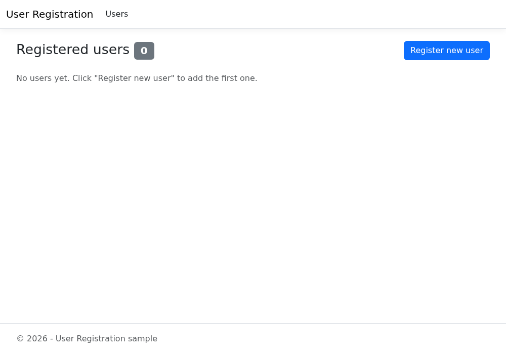
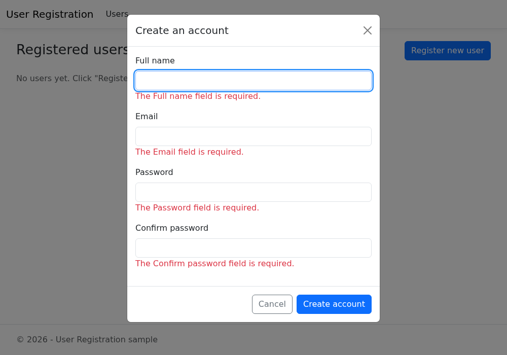
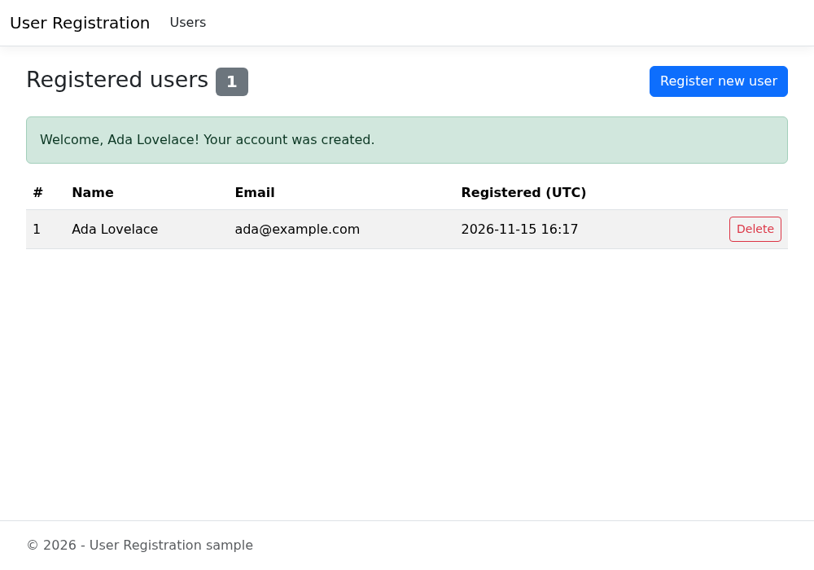
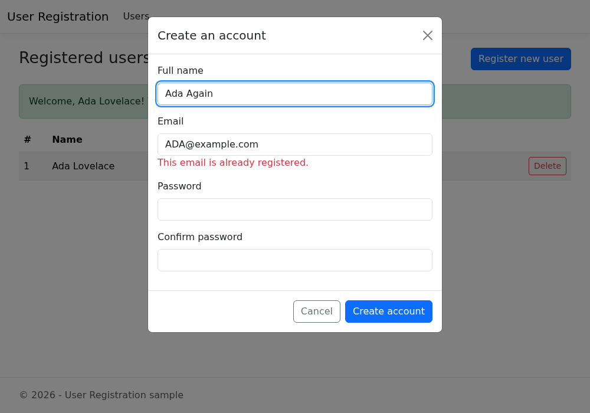
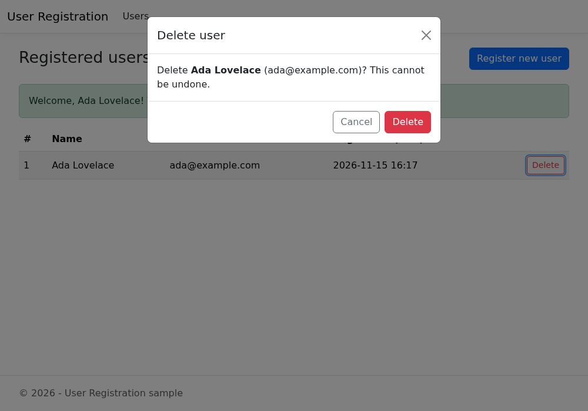

# User Registration sample

Small ASP.NET Core MVC app (.NET 10) with PostgreSQL via EF Core. It is standalone: it has its own
`Directory.Build.props` and `Directory.Packages.props` and is not part of `Talent.sln`.

- `Controllers/UsersController.cs`: list, register (modal), delete (modal)
- `Views/Users/`: `Index` page plus the `_RegisterForm` and `_DeleteConfirm` partials shown inside a Bootstrap modal
- `wwwroot/js/users.js`: loads a partial into the modal and posts it with `fetch`. 200 = done, 422 = the server re-rendered the form with errors
- `Data/AppDbContext.cs`: `users` table with a unique index on `Email`
- Passwords are hashed with ASP.NET Core `PasswordHasher`. Emails are stored lower-case and checked twice (query, then the unique index)

## Run

```bash
./scripts/pg-start.sh                      # PostgreSQL on 127.0.0.1:5433 (see docs/dev-setup.md)
cd samples/UserRegistration/UserRegistration.Web
dotnet run --urls http://localhost:5101
```

The connection string is in `appsettings.json`. The table is created on first start with `EnsureCreated`
(sample only; a real app would use migrations).

## Screenshots

| Empty | Client-side validation |
|---|---|
|  |  |
| **Registered** | **Duplicate email (server check)** |
|  |  |
| **Delete confirm modal** | |
|  | |
